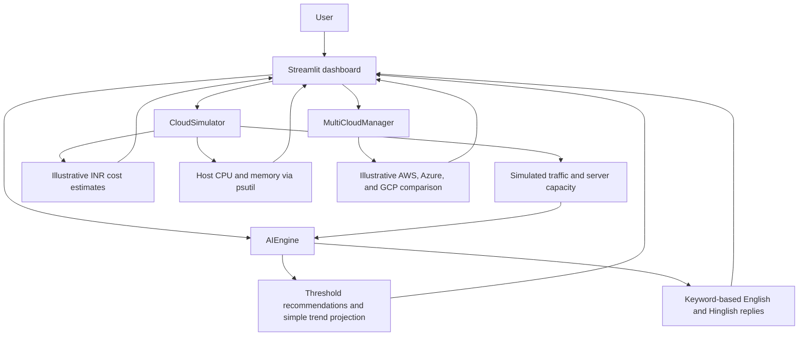

# AutoCloud AI

### GenAIOps: an interactive prototype for cloud operations, cost awareness, and governance

[](https://autocloud-ai-gnyqpi5elxhawwrvbww36e.streamlit.app/)
[](https://ijrar.org/viewfull.php?&p_id=IJRAR26A3139)
[](https://doi.org/10.56975/ijrar.v13i1.330052)
[](https://www.python.org/)
[](https://streamlit.io/)

AutoCloud AI is a simulation-first GenAIOps project that brings monitoring, scaling decisions, cost estimates, and a Hinglish-friendly operations chat into one interactive dashboard. It is both an academic research project and a working local/cloud-hosted prototype for exploring how cloud operations could be made easier to understand.

> **Scope and accuracy:** The live application simulates cloud infrastructure, traffic, provider comparisons, prices, and scaling actions. It reads CPU and memory from the machine running the app, but it does not monitor or change real AWS, Azure, or Google Cloud resources. Its decision engine is rule-based, not an LLM integration.

## Live demo and research

| Resource | Link |
| --- | --- |
| **Interactive application** | [Open AutoCloud AI](https://autocloud-ai-gnyqpi5elxhawwrvbww36e.streamlit.app/) |
| **Published research page** | [Read the paper on IJRAR](https://ijrar.org/viewfull.php?&p_id=IJRAR26A3139) |
| **DOI** | [10.56975/ijrar.v13i1.330052](https://doi.org/10.56975/ijrar.v13i1.330052) |
| **Source code** | [GitHub repository](https://github.com/Shreyansh01234/autocloud-ai) |

**Paper:** “GenAIOps: A Next-Generation Cognitive System for Automated Cloud Operations Using GenAI,” by Prof. Priya Sen and Shreyansh Pandey, *International Journal of Research and Analytical Reviews (IJRAR)*, volume 13, issue 1 (2026).

The paper presents the broader GenAIOps research concept. This repository contains a demonstration prototype: its current runtime behavior should not be confused with every capability or result discussed as part of the research vision.

## What the prototype demonstrates

- **Operations dashboard:** workload, utilization, server count, estimated hourly cost, trend sparklines, and monitoring charts.
- **Responsive demo traffic:** select normal traffic (120 users) or low traffic (35 users), or use custom traffic, to explore the dashboard.
- **Threshold-based scaling guidance:** inspect scale-up, scale-down, or maintain recommendations; autonomous and manual controls change simulated capacity only.
- **Simple trend projection:** estimate a near-term load direction from a short recent history. The displayed 75–95% confidence number is randomly generated for the demo and is **not** a calibrated model confidence.
- **English/Hinglish keyword chat:** try basic phrases such as “status batao”, “scale up”, or “help”. This is phrase matching, not general-purpose NLP or a conversational LLM.
- **Simulated cost awareness:** compare illustrative INR-based server costs, daily estimates, and provider cost factors.
- **Operational visibility:** inspect recent alerts, health indicators, system logs, and chart history filters.

## How it works



### Decision and simulation boundaries

- Traffic and server capacity are generated and kept in the running app's in-memory session; they are not cloud telemetry.
- CPU and memory readings come from the app host through `psutil`, not from a simulated or deployed cloud VM.
- Scale buttons and autonomous mode adjust the simulator's server count. No infrastructure API or provider credentials are configured.
- The cost model uses illustrative per-server/provider factors; displayed amounts are estimates for the demo, not provider quotes or invoices.
- Trend prediction uses a few recent samples. Its confidence label is randomized and should not be used for operational decisions.
- App restarts can reset in-memory simulation history and actions.

## Architecture and technology

| Component | Role |
| --- | --- |
| `app.py` | Streamlit UI, charts, controls, traffic scenarios, session state, and operations panels. |
| `components/cloud_simulator.py` | Simulated workload, server capacity, logs, history, and cost insights; reads host CPU/memory using `psutil`. |
| `components/ai_engine.py` | Utilization-threshold decisions, simple trend projection, smart-reply templates, and keyword-based chat. |
| `components/multi_cloud.py` | Illustrative AWS/Azure/GCP cost factors, provider suggestions, and simulated provider switching. |

**Stack:** Python, Streamlit, Plotly, pandas, NumPy, and psutil.

## Run locally

### Prerequisites

- Python 3.10 or later
- `pip`

### Windows PowerShell

```powershell
git clone https://github.com/Shreyansh01234/autocloud-ai.git
cd autocloud-ai
python -m venv .venv
.\.venv\Scripts\Activate.ps1
python -m pip install --upgrade pip
python -m pip install -r requirements.txt
streamlit run app.py
```

### macOS or Linux

```bash
git clone https://github.com/Shreyansh01234/autocloud-ai.git
cd autocloud-ai
python3 -m venv .venv
source .venv/bin/activate
python -m pip install --upgrade pip
python -m pip install -r requirements.txt
streamlit run app.py
```

Open the local address shown by Streamlit (usually `http://localhost:8501`). No API keys or cloud account are needed for the demo.

## Suggested walkthrough

1. Open the [live application](https://autocloud-ai-gnyqpi5elxhawwrvbww36e.streamlit.app/) and review the KPI cards and charts.
2. Select a traffic scenario and apply it to see the simulated dashboard response.
3. Compare the `15 min`, `1 hour`, `24 hours`, and `All session` chart windows.
4. Review the alerts, health, and system-log panels.
5. Try chat prompts such as `status batao`, `scale up`, and `help`.
6. Toggle autonomous mode or try manual scale controls; observe the simulated server count and estimated cost.

## Project structure

```text
autocloud-ai/
├── app.py
├── requirements.txt
├── README.md
└── components/
    ├── __init__.py
    ├── ai_engine.py
    ├── cloud_simulator.py
    ├── dashboard.py
    └── multi_cloud.py
```

## Future research and development

- Validate decision rules and forecast behavior with reproducible tests and clearly defined evaluation metrics.
- Replace the demo confidence label with a statistically evaluated forecasting method.
- Add persistent telemetry and configurable alert policies.
- Explore optional LLM-based operations assistance with explicit safeguards and verifiable explanations.
- Add carefully scoped, permissioned cloud-provider integrations, beginning with read-only telemetry.

These are possible future directions, not features currently enabled in the live demo.

## Author

Developed by [Shreyansh Pandey](https://github.com/Shreyansh01234).

## License

No `LICENSE` file is currently included in this repository. Please contact the author before reusing or redistributing the project.
