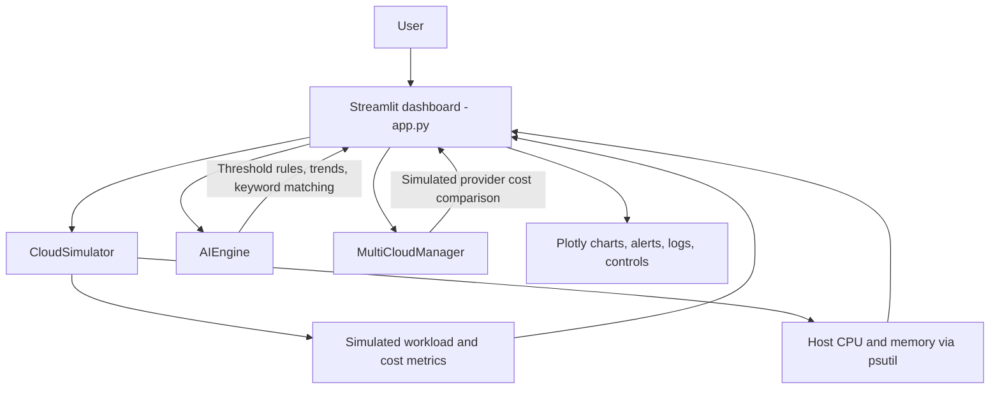

# AutoCloud AI

### A simulation-first GenAIOps dashboard for monitoring, scaling, and cloud-cost decisions

AutoCloud AI is a Streamlit academic project that brings cloud-operations concepts into one interactive dashboard. It combines live host CPU and memory readings with simulated traffic, rule-based scaling guidance, operational alerts, and estimated costs—so the workflow can be explored locally without cloud credentials or infrastructure.

> **Project scope:** cloud traffic, infrastructure, provider comparisons, scaling actions, and cost figures are simulated. The AI component uses transparent heuristics; it does not call an LLM or provision real cloud resources.

[](https://www.python.org/)
[](https://streamlit.io/)
[](https://plotly.com/python/)

## What it demonstrates

- **Operations dashboard:** workload, utilization, server count, estimated hourly cost, and recent metric trends.
- **Traffic scenarios:** switch between normal traffic (120 users), low traffic (35 users), and a spike scenario (500 users) to explore system responses.
- **Monitoring and observability:** view time-series charts, health indicators, alerts, and a dedicated system-log panel.
- **Scaling workflow:** review heuristic recommendations in autonomous mode or trigger simulated scale-up and scale-down actions manually.
- **Cost and provider comparisons:** explore estimated cost insights and simulated multi-cloud comparisons without connecting provider accounts.
- **Interactive exploration:** filter chart history by time range, review recent decisions, and use the built-in keyword-based operations chat.

## Architecture



### Main modules

| Module | Responsibility |
| --- | --- |
| `app.py` | Streamlit page, dashboard layout, charts, controls, alerts, and session state. |
| `components/cloud_simulator.py` | Generates demo workload and cost data, tracks simulated capacity, and reads host CPU/memory with `psutil`. |
| `components/ai_engine.py` | Applies threshold-based scaling rules, simple trend analysis, and keyword-based chat responses. |
| `components/multi_cloud.py` | Produces simulated provider and cost comparisons. |

## Run locally

### Requirements

- Python 3.10 or later
- `pip`

### Windows (PowerShell)

```powershell
git clone https://github.com/Shreyansh01234/autocloud-ai.git
cd autocloud-ai
python -m venv .venv
.\.venv\Scripts\Activate.ps1
python -m pip install --upgrade pip
python -m pip install -r requirements.txt
streamlit run app.py
```

### macOS / Linux

```bash
git clone https://github.com/Shreyansh01234/autocloud-ai.git
cd autocloud-ai
python3 -m venv .venv
source .venv/bin/activate
python -m pip install --upgrade pip
python -m pip install -r requirements.txt
streamlit run app.py
```

Streamlit prints the local address after startup; the default is `http://localhost:8501`. No API keys or cloud account are required.

## Suggested demo walkthrough

1. Start the app and review the KPI cards and monitoring charts.
2. Select the traffic-spike scenario and observe how utilization, alerts, and scaling guidance respond.
3. Compare the `15 min`, `1 hour`, `24 hours`, and `All session` chart windows.
4. Review the system-health and log panels, then try the manual scaling controls or autonomous mode.
5. Return to normal or low traffic and observe the simulated workload response.

The dashboard labels its simulation mode so demo data and actions are not mistaken for production infrastructure.

## Technology

- **Python** — application logic and simulation
- **Streamlit** — interactive web UI
- **Plotly** — monitoring charts
- **pandas / NumPy** — metric and time-series calculations
- **psutil** — host CPU and memory readings

Install the exact dependency set with `python -m pip install -r requirements.txt`.

## Limitations and responsible use

- Cloud providers, workloads, scaling operations, and cost figures are **simulated**; this project does not create, modify, or monitor AWS, Azure, or Google Cloud resources.
- CPU and memory readings come from the machine running the app; they are not metrics from a deployed cloud workload.
- Scaling recommendations, trend estimates, and chat replies are heuristic/demo behavior, not generative AI or production-grade policy decisions.
- Session data is intended for local demonstration and is not a persistent monitoring or alerting service.
- Do not use the demo recommendations to make production capacity, availability, or spending decisions.

## Project structure

```text
autocloud-ai/
├── app.py
├── requirements.txt
├── README.md
└── components/
    ├── __init__.py
    ├── ai_engine.py
    ├── cloud_simulator.py
    ├── dashboard.py
    └── multi_cloud.py
```

## Possible next steps

- Add unit tests for scaling thresholds, traffic scenarios, and cost calculations.
- Add persistent metric storage and configurable alert thresholds.
- Integrate a real cloud provider behind explicit credentials, permissions, and a safe read-only-first workflow.
- Evaluate an optional LLM-based operations assistant with clear safeguards and source-grounded responses.

These are future directions, not features currently enabled in the local demo.

## Author

Developed as an academic portfolio project by [Shreyansh Pandey](https://github.com/Shreyansh01234).

## License

No `LICENSE` file is currently included. Please contact the author before reusing or redistributing this project.
